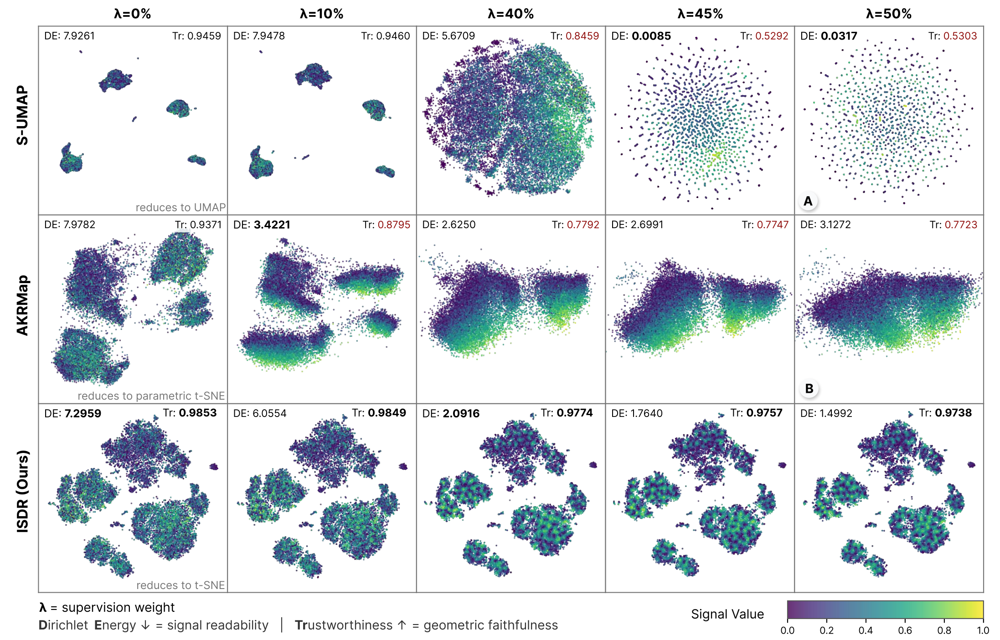

# Beyond Contraction: Geometry-Faithful Supervised Dimensionality Reduction for Data Visualization

**NeurIPS 2026** · [Paper](https://nips.cc/virtual/2026/loc/sydney/poster/155065)

Xu Zhu, Yilin Ye, and Shixia Liu



*Figure 1. Comparison on the LLM-as-a-Judge case under varying supervision weights λ. Color shows judge confidence; columns use a fine grid around the S-UMAP collapse thresholds.*

## Abstract

Supervised dimensionality reduction (DR) is widely used in visualization to reveal task-specific structure in high-dimensional data. However, in regression settings with continuous supervision, existing methods often improve signal readability at the cost of severe neighborhood distortion, limiting the reliability of the resulting visualization. To understand this trade-off, we provide a theoretical analysis that characterizes the relationship between geometric faithfulness and signal readability through two finite-sample proxies for the readout's bi-Lipschitz properties: contraction (co-Lipschitz) and smoothness (Lipschitz). We show that contraction can impose a sharp geometric distortion floor in many existing methods, whereas smoothness alone is sufficient to support effective visualization. In particular, directly regularizing smoothness yields first-order regularity gains with only second-order geometry loss, under geometry-first initialization near a local geometry optimum. Guided by this insight, we propose ISDR (Interpretable Supervised DR), a nonparametric method that preserves geometric structure while enforcing readout smoothness. Experiments on HPDv3 and Tabula Muris show that ISDR improves the geometry–signal Pareto frontier, reducing local signal variation while retaining faithful neighborhoods compared with representative supervised DR baselines.

## Repository contents

This release includes the ISDR method, public-data benchmark runners, ablations, and a Tabula Muris importer. HPDv3 judge-feature extraction is not included.

| Directory | Contents |
|---|---|
| [isdr](isdr/) | ISDR, baseline adapters, data loaders, metrics, and plotting |
| [configs](configs/) | Ready-to-run experiment settings |
| [scripts](scripts/) | Benchmark, ablation, and plotting commands |
| [docs](docs/) | [Dataset and experiment protocols](docs/EXPERIMENTS.md), [method settings](docs/METHODS.md) |

## Quick start

Use Python 3.10 or newer:

```bash
git clone https://github.com/Circular-Aflame/ISDR.git
cd ISDR
python -m pip install -e '.[public-data,regression-data,accelerate]'
```

The supervision weight is `alpha` in configuration files (`λ` in the paper). Run a small example using the built-in digits dataset:

```bash
python -m isdr.cli run --config configs/smoke_digits.yaml
```

The example compares PCA, t-SNE, and ISDR and saves coordinates, metrics, plots, and run settings under `results/smoke_digits/`. Run the commands below from the repository root. Downloaded datasets are cached in `data/`.

### Use your own data

Pass a feature matrix and one scalar signal per row. Standardize features before calling ISDR:

```python
from sklearn.datasets import load_diabetes
from sklearn.preprocessing import StandardScaler
from isdr import fit_transform

X, signal = load_diabetes(return_X_y=True)
X = StandardScaler().fit_transform(X)
Y = fit_transform(X, signal, alpha=0.4, random_state=42)
```

`Y` has shape `(n_samples, 2)`, in the same row order as `X`. This call writes no files. See [Python usage](docs/METHODS.md#python-usage) for initialization and refinement options.

## Benchmarks

Compare PCA, t-SNE, and ISDR on six public tabular regression datasets and four image classification datasets:

```bash
python -m isdr.cli prepare-regression-benchmarks --dataset all
python scripts/run_regression_benchmarks.py --methods pca tsne isdr
python scripts/run_classification_benchmarks.py --methods pca tsne isdr
```

Both runners use five seeds: 42, 123, 456, 789, and 2026. Add `--quick --seeds 42` for a short execution check, or `--datasets <name>` to select a dataset. Use the default budgets for method comparisons. Results are saved in `results/regression_benchmarks/` and `results/classification_benchmarks/`.

To include all baselines, install their dependencies and omit `--methods` from the commands above:

```bash
python -m pip install -e '.[baselines]'
python scripts/install_rf_baselines.py
```

Classification benchmarks evaluate labeled layouts. Their Dirichlet energy depends on label ordering and does not measure held-out prediction accuracy. See the [experiment protocols](docs/EXPERIMENTS.md) for dataset sources, sampling, Tabula Muris preparation, and plotting commands.

## Ablations

With the baselines installed, compare initialization, refinement schedules, neighborhood supports, and shared-start layouts:

```bash
python scripts/ablations/run_ablations.py --config configs/ablations/digits.yaml
```

Use `--groups` to select studies or `--quick --seeds 42` for a short execution check. The [ablation guide](docs/EXPERIMENTS.md#ablations) describes each comparison; [method settings](docs/METHODS.md) explain the configuration parameters and baseline adaptations.

## Citation

If you use ISDR in your research, please cite:

```bibtex
@inproceedings{zhu2026isdr,
  title     = {Beyond Contraction: Geometry-Faithful Supervised Dimensionality Reduction for Data Visualization},
  author    = {Zhu, Xu and Ye, Yilin and Liu, Shixia},
  booktitle = {Advances in Neural Information Processing Systems},
  year      = {2026},
  url       = {https://nips.cc/virtual/2026/loc/sydney/poster/155065}
}
```

## License and credits

ISDR is released under the [MIT license](LICENSE). The AKRMap and TP-SE baselines are tabular adaptations of [yilinye/AKRMap](https://github.com/yilinye/AKRMap) ([MIT notice](licenses/AKRMap-MIT.txt)) and [JohnNellas/TPSE-PyTorch](https://github.com/JohnNellas/TPSE-PyTorch) ([BSD 3-Clause notice](licenses/TPSE-BSD-3-Clause.txt)).

Other baselines use upstream packages under their own licenses. Datasets are downloaded separately and remain subject to their providers' terms.
